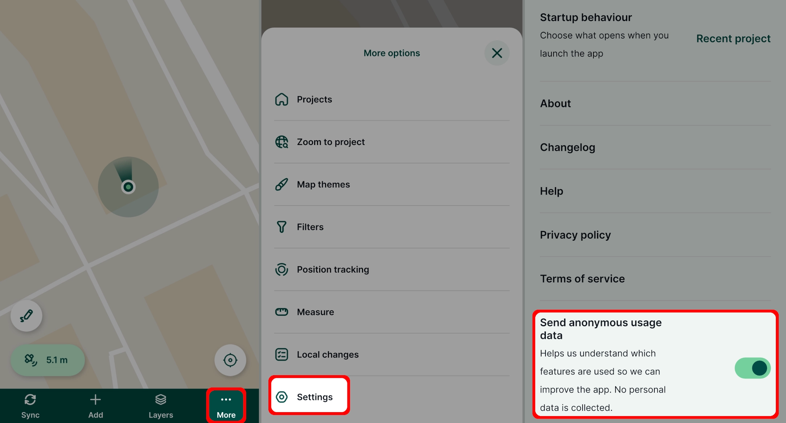

# Telemetry
Anonymous usage reports help us to improve the user experience by providing insights into which features are valuable to <MainPlatformName /> users and how they interact with <MobileAppNameShort />.

The usage reports are anonymous and do not contain personal data.

You can opt out anytime in [Settings](../../field/mobile-app-ui/#general):

